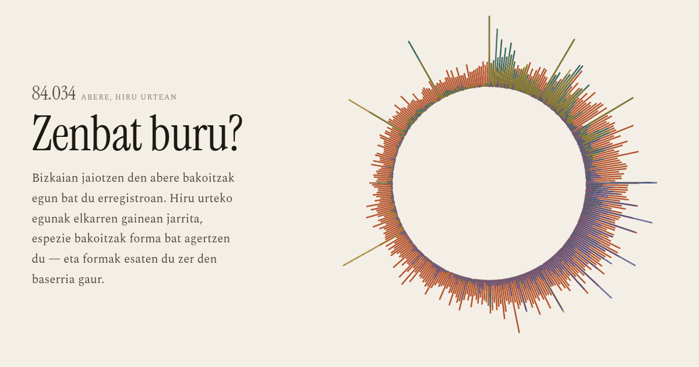

# Zenbat buru?

**▶ https://zenbatburu.berezuma.com**

Bizkaian **84.034 abere** jaio eta erregistratu dira hiru urtean (2023–2025).
Abere bakoitzak egun bat du erregistroan, eta hiru urteko egunak elkarren
gainean jarrita espezie bakoitzak forma bat agertzen du: arkumeak neguan,
moxalak udaberrian. Baina erregistroak ez du dena ikusten — eta hori ere
forma bat da.



## Zer erakusten duten datuek

| | Kopurua |
|---|---|
| Abereak guztira, 2023–2025 | 84.034 |
| Behiak | 50.194 |
| Ardiak | 22.122 |
| Ahuntzak | 5.644 |
| Zaldiak | 5.403 |
| Astoak | 663 |
| Mandoak | 8 |

**Hiru aurkikuntza.**

**1 · Erregistroak ez ditu jaiotza guztiak ikusten.** Behietan emeak % 51,9
dira eta arrak % 48,1 — biologiak hori ematen du. Ardietan erregistratutako
animalien **% 90,9 emeak** dira, eta ahuntzetan % 87,5. Ardiek ez dituzte hamar
aldiz ahari gutxiago egiten: ustiategitik lehenago ateratzen direnak ez dira
zerrenda honetara iristen. Erregistroak ikusten duena ez da jaio dena,
gelditzeko zena baizik.

**2 · Egunak biribilduta daude; hilabeteak ez.** Animalien **% 16,1 hilabete
baten lehen egunean** dago idatzita — 13.521 abere hamabi egunetan. Ardietan
% 38,6 eta ahuntzetan % 38,0; behietan % 4,5 bakarrik. Egun zehatza ez da beti
jakina, eta hilaren lehena idazten da. Horregatik ez da orrian egun bati buruzko
baieztapenik egiten: hilabetea da neurri fidagarria.

**3 · Katalogo ofizialak ez du iragartzen zer ari den gertatzen.** Euskal Arraza
Autoktonoen Katalogo Ofizialak ([81/2015 Dekretua][d81], EHAA 110, 2015-06-15)
hamalau abere-arraza babesten ditu. Erregistroak hamaika ikusten ditu — txerriak
eta hegaztiak ez dira banan-banan identifikatzen — eta arrisku-mailak ez du
norabidea asmatzen:

| Arraza | 81/2015 | 2023 | 2025 |
|---|---|---|---|
| Azpigorri | Kritikoa | 698 | **337** |
| Monchina | Kritikoa | 348 | **440** |
| Sasi Ardi | Arriskuan | 827 | 546 |
| Carranzana | Arriskuan | 1.309 | 976 |
| Terreña | Arriskuan | 639 | **795** |
| Pottoka | Arriskuan | 96 | **174** |
| Euskal Herriko Mendiko Zaldia | Arriskuan | 316 | **557** |
| Betizu | Arriskuan | 41 | 42 |
| Euskal Txerria · Oiloa · Antzara | Kritikoa | — | — |

Hiru urtean **117 betizu** jaio dira Bizkaian. Urtean berrogei inguru.

[d81]: https://www.euskadi.eus/bopv2/datos/2015/06/1502621a.pdf

## Iturria

[Open Data Bizkaia](https://www.opendatabizkaia.eus/es/catalogo/explotaciones-ganaderas),
`explotaciones-ganaderas` datu-multzoa, CKAN `datastore_search` APIaren bidez.
Hiru taula-mota pakete berean:

| Taula | Ilarak | Aldia |
|---|---|---|
| Ustiategien erregistroa | 52.488 | 2021–2025 |
| Jaiotzak | 84.058 | 2023–2025 (+13 sakabanatuta) |
| Mugimenduak | 63.809 gida · 4.708.071 abere | 2023–2025 |

Arrazen egoera ofiziala 81/2015 Dekretutik dator. Ez da beste daturik erabili.

Kontuan hartzekoak:

- **Hiru urte osoak bakarrik.** Jaiotzen taulan 13 ilara daude 2008tik 2026ra
  sakabanatuta, eta urte horiek ez daude osorik. Beste 11 ilarak
  identifikazio-zenbakia errepikatzen zuten, eta behin bakarrik zenbatu dira:
  **84.034 abere**.
- **Arrazak familia mailan.** Iturriak arraza bera bi mailatan etiketatzen du:
  batzuetan familia («LATXA») eta batzuetan aldaera («LATXA CARA NEGRA»).
  Aldaeren serieak, beraz, ez dira fidagarriak. Dena familia mailan neurtzen da.
- **Eremuen izenak elebidunak dira** («UDALERRIA/MUNICIPIO»), eta gaztelaniazko
  erdiaren bidez bilatu behar dira zehazki: `LUGAR_DESTINO` bilatzeak
  `CODIGO_LUGAR_DESTINO` harrapatzen du bestela, eta kodea itzultzen du
  izenaren ordez.
- **Gidak ez dira animaliak.** Animalia bera urtean behin baino gehiagotan mugi
  daiteke, eta sorta batek 35.840 abere izan ditzake. Bi zifrak ematen dira
  beti, eta inoiz ez dira jaiotzen zifrarekin batzen.

## Nola eraiki

```
python3 build.py      # datuak jaitsi (~147 MB data/raw-*.json)
python3 compact.py    # data/abereak.json sortu (459 KB)
python3 verify.py     # 53 zifra iturri gordinetik berriro kalkulatu
python3 assemble.py   # index.html muntatu
node make-og.js       # zenbat-buru-og.png sortu
node make-doc.js      # AURKEZPENA.pdf sortu
```

Lehen urratsa behin bakarrik behar da: `data/abereak.json` biltegian dago.

Partekatzeko etiketek URL absolutua behar dute, eta ostatu-helbidetik hartzen da:

```
SITE_URL=https://zenbatburu.berezuma.com python3 assemble.py
```

Hutsik utziz gero, URL absolutua behar duten etiketak (`og:url`, `canonical`)
kendu egiten dira — okerreko URL bat baino hobe da bat ere ez.

## Egiaztapena

`verify.py`-k orrian argitaratutako **53 zifra** iturri gordinetik berriro
kalkulatzen ditu, `compact.py`-tik independenteki. Prozesu horrek hiru akats
aurkitu zituen argitaratu aurretik:

- urteko zifrak bikoiztuak kendu aurretikoak ziren (29.626 → **29.619**);
- arkumeak negu-hilabeteetan % 59 zirela esaten zen, eta % 58,3 dira;
- moxalak «hamabi aldiz gutxiago» urtarrilean, eta **hogeita hiru** aldiz dira.

## Fitxategiak

```
CNAME                      ostatu-domeinua (GitHub Pages)
index.html                 orri osoa, fitxategi bakarrean (546 KB)
zenbat-buru-og.png      partekatzeko txartela
build.py                   Open Data Bizkaiatik jaitsi
compact.py                 garbitu, arrazak batu eta formatu trinkora pasatu
verify.py                  zifra bakoitza iturritik berriro kalkulatu
assemble.py                burua + gorputza + datuak + gidoia → orri bakarra
make-og.js                 txartela atera (Chrome, CDP bidez)
make-doc.js                AURKEZPENA.md → AURKEZPENA.pdf (Chrome, CDP bidez)
page.head.html             metadatuak eta CSS osoa
page.body.html             egitura
page.script.html           itzulpenak eta bistaratze-kodea
data/abereak.json          orriak jaten duen datu-multzoa (459 KB)
AURKEZPENA.md              sarirako dokumentazio teknikoa (eu/es)
AURKEZPENA.pdf             dokumentazio bera, izapidera eransteko (A4, 7 orri)
```

`data/raw-*.json` (147 MB) ez dago biltegian: `build.py`-k berriro sortzen ditu.

## Nola dagoen egina

Bistaratzea **eskuz idatzitako canvas, SVG eta JavaScript hutsa** da,
kanpo-liburutegirik gabe. Eszena nagusia eraztun bat da: 84.034 marratxo
erradial fotograma bakoitzean, bakoitza abere bat, bere jaiotze-eguneko
angeluan. Eguna → angelua mapaketa bakarra da eszena guztietan, eta horregatik
marratxoak erradialki bakarrik mugitzen dira: begiak abere berberak jarraitu
ahal die eraztun handia bost gurpil bihurtzen denean.

Abere bakoitza lau byte dira: eguna, urtea, espeziea eta sexua zenbaki
bakarrean bilduta (`Uint16`), eta arraza eta udalerria byte bana. 84.034
abere 459 KB-tan, orriak datu guztiak barruan eraman ditzan.

Tipografia: **Instrument Serif** izenburuetan eta **Spectral** irakurketan eta
zifretan. Kolore-sistemak bost tonu ditu, espezie bakoitzeko bat, eta ez dira
beste ezertarako erabiltzen: azpimarratzeko gainerakoa ilundu egiten da.

Orriak euskaraz eta gaztelaniaz funtzionatzen du, egoera URLan gordetzen du
(`#lang=es&f=kat`), CSV gisa deskargatzen uzten du, teklatuz nabigatzen da eta
paperean inprimatzen da.

## Lizentzia

| Zer | Lizentzia |
|---|---|
| Kodea | MIT |
| Testuak eta grafikoak | CC BY 4.0 |
| Datuak | Bizkaiko Foru Aldundiarenak, Open Data Bizkaia |
